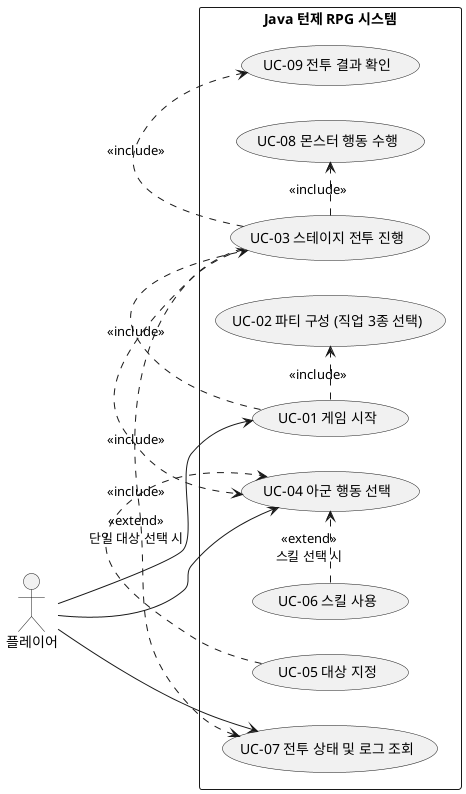
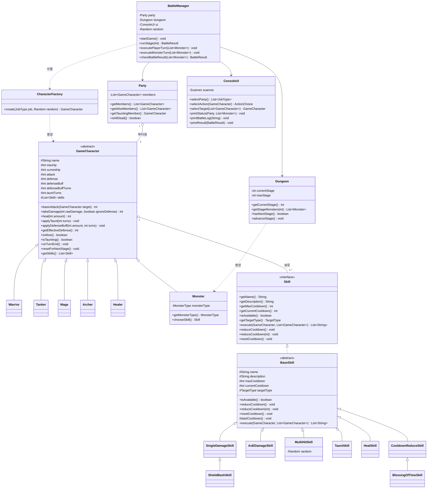

# 소프트웨어 요구사항 명세서 (Software Requirements Specification)

* **프로젝트명:** Java 기반 텍스트 턴제 RPG (Dungeon Crawler)
* **작성자:** 진상현(2022245142), 김도현(2022245128)

---

## 1. 개요 (Introduction)

### 1.1 목적
본 문서는 콘솔 환경에서 실행되는 Java 기반 턴제 RPG의 기능적·비기능적 요구사항, 데이터 규격, 핵심 인터페이스 규약 및 객체지향 클래스 구조를 명세하여 팀원 간 구현 기준을 통일하는 것을 목적으로 한다.

### 1.2 시스템 범위
* **파티 구성:** 전사, 탱커, 마법사, 궁수, 힐러 중 중복되지 않는 3종의 직업을 선택해 파티 구성.
* **던전 진행:** 총 5개 스테이지로 구성된 던전을 순차적으로 공략.
* **인터페이스:** 게임 진행, 캐릭터 상태, 전투 결과 및 로그는 텍스트 기반 콘솔 UI로 출력.
* **전투 방식:** 턴제로 진행하며, 플레이어는 아군의 행동과 유효한 행동 대상을 직접 선택.
* **범위 외(Out of Scope):** GUI, 네트워크, 저장/불러오기, 아이템, 레벨업/경험치, 속도(행동 순서) 스탯은 구현하지 않음.

### 1.3 개발 환경 및 제약
* **언어 및 환경:** Java (JDK 17 이상), 표준 라이브러리만 사용(외부 라이브러리 미사용).
* **패키지 구조:** `model.common`, `model.character`, `model.skill`, `model.dungeon`, `engine`, `ui`
* **난수 처리:** `java.util.Random` 인스턴스를 생성자 주입한다. 무작위 타겟 선택과 다단 공격은 동일한 게임 난수 인스턴스를 공유해 시드 기반 재현 테스트가 가능하도록 한다.

---

## 2. 요구사항 명세 (Requirements Specification)

### 2.1 기능적 요구사항 (Functional Requirements)

| ID | 분류 | 요구사항명 | 상세 설명 |
|---|---|---|---|
| **FR-01** | 파티 구성 | 직업 선택 및 파티 생성 | 5개 직업 중 중복되지 않는 3개 직업을 선택해 `Party`를 구성한다. 선택 시 직업별 능력치와 스킬 설명을 출력한다. |
| **FR-02** | 던전 진행 | 5단계 스테이지 구성 | 1~2스테이지는 일반 몬스터 3마리, 3스테이지는 중간보스 1마리, 4스테이지는 정예 몬스터 3마리, 5스테이지는 최종보스 1마리로 구성한다. |
| **FR-03** | 전투 진행 | 턴제 행동 선택 | 각 라운드에서 생존한 파티원은 파티 목록 순서대로 기본 공격, 일반 스킬, 궁극기 중 하나를 선택한다. 사용 불가 스킬은 실행하지 않고 재선택을 요청한다. 행동 중 사망하거나 전투가 종료된 대상은 이후 행동에서 제외한다. |
| **FR-04** | 타겟팅 | 행동 대상 지정 | 타겟 유형은 시전자 기준으로 해석한다. 플레이어 캐릭터의 단일 대상 스킬은 유효한 대상 중 사용자가 선택하고, 몬스터의 단일 대상 스킬은 AI가 선택한다. 전체 대상은 생존한 유효 대상 목록을 자동 수집하며, `SELF`는 시전자 자신을 대상으로 한다. 무작위 다단 공격은 `ENEMY_RANDOM`으로 구분한다. |
| **FR-05** | 스킬 시스템 | 쿨타임 및 효과 처리 | 단일·광역 피해, 무작위 다단 피해, 도발, 방어 증가, 회복, 쿨타임 감소를 처리한다. 스킬은 모든 대상과 효과를 처리한 뒤 자신의 쿨타임을 설정한다. 쿨타임 감소 및 지속시간의 정확한 차감 시점은 2.4절 규칙을 따른다. |
| **FR-06** | 몬스터 AI | 적 행동 및 도발 판정 | 생존 몬스터는 사용 가능한 특수 스킬 중 우선순위가 가장 높은 스킬을 사용하고, 없으면 기본 공격한다. 몬스터의 단일 대상 공격은 생존 도발자가 있으면 해당 캐릭터를 대상으로 하며, 없으면 생존 파티원 중 무작위로 선택한다. 광역 공격은 생존 파티원 전체를 대상으로 한다. |
| **FR-07** | 승패 판정 | 스테이지 및 게임 종료 | 모든 개별 행동 직후 전투 결과를 확인한다. 몬스터 전멸 시 현재 스테이지를 종료하고, 5스테이지의 몬스터를 전멸시키면 승리한다. 파티 전멸 시 즉시 패배하며 남은 행동은 수행하지 않는다. |
| **FR-08** | 상태 출력 | 전투 상태 및 로그 출력 | 매 턴 아군·적군의 HP, 생존 여부, 쿨타임, 버프/도발 상태와 모든 행동 결과 로그를 출력한다. |
| **FR-09** | 입력 검증 | 사용자 입력 오류 처리 | 문자 입력, 범위 이탈, 사망 대상 선택, 쿨타임 중 스킬 선택, 중복 직업 선택 시 오류 안내 후 재입력을 요청한다. |
| **FR-10** | 스테이지 전환 | 스테이지 간 상태 처리 | 다음 스테이지가 존재할 때 생존 아군은 최대 HP의 30%만큼 회복한다(최대 HP 초과 불가). 모든 아군의 스킬 쿨타임과 도발·방어 버프를 초기화한다. 사망자는 부활하지 않는다. 최종 스테이지 클리어 후에는 회복 처리를 하지 않는다. |

### 2.2 비기능적 요구사항 (Non-Functional Requirements)
* **NFR-01 확장성:** 신규 직업은 `GameCharacter`, 신규 스킬은 `BaseSkill`을 상속해 추가하며, `BattleManager`는 `Skill` 인터페이스에만 의존한다.
* **NFR-02 계층 분리:** 도메인(`model.*`), 전투 엔진(`engine`), 입출력(`ui`)을 분리한다. 도메인 클래스는 `Scanner`나 `System.out`에 직접 의존하지 않으며, 전투 로그는 `List<String>`으로 반환해 `ConsoleUI`가 출력한다.
* **NFR-03 신뢰성 및 무결성:** 잘못된 입력으로 프로그램이 강제 종료되지 않으며, HP(`0 ~ maxHp`), 쿨타임 및 버프 지속 턴(`0` 이상)의 범위를 항상 보장한다.

### 2.3.1 전투 규칙의 공통 정의
* **라운드:** 아군 행동 단계와 몬스터 행동 단계를 한 번씩 수행하는 단위다. 각 단계에서는 해당 시점에 생존한 개체만 행동한다.
* **행동 중 전투 종료:** 아군 행동으로 몬스터가 전멸하면 남은 아군 행동과 몬스터 행동을 모두 생략한다. 몬스터 행동으로 파티가 전멸하면 남은 몬스터 행동을 생략한다.
* **대상 유효성:** 공격 대상은 행동 실행 직전에 생존 여부를 다시 검사한다. 이미 사망한 대상은 대상 목록에서 제외한다. 유효 대상이 없으면 행동을 실행하지 않고 로그를 남긴다.
* **행동 선택 취소:** 별도 취소 기능은 제공하지 않는다. 잘못된 입력이나 사용 불가 스킬 선택은 현재 행동을 소비하지 않고 재입력한다.
* **기본 공격:** 기본 공격의 원피해량은 시전자 `ATK`이며, 최종 피해량은 스킬 피해 공식과 동일하게 계산한다. 기본 공격에는 쿨타임이 없다.

### 2.4 상태 효과 및 쿨타임의 시간 규칙
* **쿨타임 기준:** 스킬 사용 라운드를 제외하고 이후 라운드 종료 시마다 1 감소한다. 예를 들어 쿨타임 2인 스킬은 사용한 다음 두 라운드 동안 사용할 수 없고, 그 다음 라운드부터 사용할 수 있다.
* **쿨타임 적용 순서:** 스킬 효과와 로그를 처리한 뒤 해당 스킬의 `currentCooldown`을 `maxCooldown`으로 설정한다. 따라서 쿨타임 감소 효과가 자기 자신의 쿨타임을 감소시키더라도, 사용 스킬의 쿨타임 설정이 마지막에 적용된다.
* **라운드 종료 갱신:** 각 캐릭터가 보유한 스킬의 쿨타임은 해당 라운드에 사용되지 않은 경우에만 1 감소한다. 도발 및 방어 버프 지속시간은 라운드 종료 시 1 감소한다. 지속시간이 0이 되면 해당 효과 수치를 제거한다.
* **버프 갱신:** 동일한 방어 버프가 다시 적용되면 중첩하지 않고 방어 증가량과 지속시간을 새 적용값으로 교체한다. 도발도 재적용 시 지속시간을 새 값으로 갱신한다.
* **방어력:** `유효 방어력 = 기본 DEF + 현재 방어 버프량`으로 계산한다. 피해량은 최소 1이며, 방어 무시 공격은 기본 DEF와 버프를 모두 무시한다.
* **회복:** 회복 후 HP는 `maxHp`를 초과할 수 없다. 사망한 캐릭터는 회복할 수 없으며, 부활 효과는 존재하지 않는다.
* **시간의 축복:** 생존한 아군 전체를 회복하고, 생존 아군이 보유한 모든 스킬의 쿨타임을 1 감소시킨다. 단, 시전자의 해당 스킬 쿨타임은 스킬 실행 마지막 단계에서 최대 쿨타임으로 설정한다.
* **초기 쿨타임 1인 몬스터 스킬:** 첫 몬스터 행동 단계에서는 사용할 수 없으며, 라운드 종료 갱신 후 쿨타임이 0이 된 다음 몬스터 행동 단계부터 사용할 수 있다.

### 2.3 전투 라운드 진행 순서
1. 아군·적군의 현재 상태 출력
2. **아군 행동 단계:** 생존 파티원 순서대로 행동 선택 및 실행 (각 행동 직후 몬스터 전멸 시 스테이지 클리어 처리)
3. **몬스터 행동 단계:** 생존 몬스터 순서대로 행동 실행 (각 행동 직후 파티 전멸 시 패배 종료)
4. **라운드 종료 처리:** 생존 여부와 관계없이 전투에 참여 중인 모든 캐릭터의 상태 카운터를 갱신한다. 단, 해당 라운드에 사용한 스킬의 쿨타임은 사용 직후 같은 라운드에 감소하지 않는다. 도발·방어 버프 지속시간의 계산은 2.4절을 따른다.

---

## 3. 데이터 규격 정의 (Data Specifications)

### 3.1 직업별 기본 능력치 및 스킬 구성

| 직업 | 최대 HP | ATK | DEF | 일반 스킬 (쿨타임) | 궁극기 (쿨타임) |
|---|---:|---:|---:|---|---|
| **전사 (`Warrior`)** | 150 | 35 | 14 | 강타: 적 1명 단일 피해 (2턴) | 회전베기: 적 전체 광역 피해 (4턴) |
| **탱커 (`Tanker`)** | 220 | 20 | 16 | 방패 강타: 적 1명 피해 + 자신 DEF 증가 (2턴) | 철벽 도발: 자신을 도발 상태로 만듦 (4턴) |
| **마법사 (`Mage`)** | 100 | 45 | 8 | 파이어볼: 적 1명 단일 피해 (2턴) | 메테오: 적 전체 광역 피해 (5턴) |
| **궁수 (`Archer`)** | 120 | 40 | 10 | 정밀 사격: 적 1명 방어 무시 피해 (2턴) | 연발 사격: 무작위 적 3회 연속 피해 (4턴) |
| **힐러 (`Healer`)** | 110 | 15 | 12 | 치유의 빛: 아군 1명 HP 회복 (2턴) | 시간의 축복: 아군 전체 회복 + 쿨타임 1 감소 (5턴) |

### 3.2 스킬 상세 규격
* **피해량 공식:** `원피해량 = (int) Math.floor(시전자 ATK * 배율)`, `최종 피해량 = Math.max(1, 원피해량 - 대상 유효방어력)` (방어 무시 시 원피해량 그대로 적용)

| 스킬명 | 구현 클래스 | TargetType | 효과 수치 및 세부 규칙 |
|---|---|---|---|
| 강타 | `SingleDamageSkill` | `ENEMY_SINGLE` | 배율 1.8 |
| 회전베기 | `AoEDamageSkill` | `ENEMY_ALL` | 배율 1.2 |
| 방패 강타 | `ShieldBashSkill` | `ENEMY_SINGLE` | 배율 1.2, 시전자 DEF +6 (2턴, 중첩 불가/지속시간 갱신) |
| 철벽 도발 | `TauntSkill` | `SELF` | 도발 2턴 (몬스터 단일 공격 타겟 고정) |
| 파이어볼 | `SingleDamageSkill` | `ENEMY_SINGLE` | 배율 1.8 |
| 메테오 | `AoEDamageSkill` | `ENEMY_ALL` | 배율 1.5 |
| 정밀 사격 | `SingleDamageSkill` | `ENEMY_SINGLE` | 배율 1.5, 방어 무시(`ignoreDefense = true`) |
| 연발 사격 | `MultiHitSkill` | `ENEMY_RANDOM` | 배율 0.8 × 3회, 매 타격 직전에 생존 적 목록을 다시 만들고 무작위 1명을 선택한다. 같은 적이 여러 번 선택될 수 있으며 생존 적이 없으면 남은 타격을 중단한다. |
| 치유의 빛 | `HealSkill` | `ALLY_SINGLE` | 고정 회복 40 |
| 시간의 축복 | `BlessingOfTimeSkill` | `ALLY_ALL` | 고정 회복 20 + 아군 전체 모든 스킬 쿨타임 1 감소 |

### 3.2.1 피해·회복·타겟 처리 세부 규칙
* 모든 배율 피해는 `원피해량 = floor(시전자 ATK × 배율)`로 계산한다.
* 방어 적용 피해는 `max(1, 원피해량 - 대상 유효 방어력)`이며, 방어 무시 피해는 `max(1, 원피해량)`이다.
* 광역 피해는 행동 실행 시점에 생존한 대상 각각에게 개별 계산해 적용한다.
* 단일 스킬의 타겟 후보는 시전자와 반대 진영의 생존 캐릭터다. 아군 단일 회복의 후보는 시전자와 같은 진영의 생존 캐릭터다.
* 스킬 실행 시 전달되는 `targets`는 위 규칙으로 검증·확정된 대상 목록이어야 한다. 스킬 구현체는 잘못된 진영 또는 사망 대상에 효과를 적용해서는 안 된다.

### 3.3 스테이지 및 몬스터 규격
*(몬스터 특수 스킬은 전투 시작 시 초기 쿨타임 1로 설정한다. 쿨타임 0인 스킬이 여러 개면 표에 기재된 우선순위가 높은 스킬부터 선택한다. 드래곤은 화염 브레스가 1순위, 포효가 2순위다.)*

| 스테이지 | 몬스터명 (등급) | 개체 수 | HP | ATK | DEF | 특수 스킬 (클래스 / 배율 / 쿨타임) |
|---:|---|---:|---:|---:|---:|---|
| **1** | 고블린 (`NORMAL`) | 3 | 80 | 18 | 5 | 없음 (기본 공격만 수행) |
| **2** | 스켈레톤 (`NORMAL`) | 3 | 100 | 22 | 8 | 뼈 던지기 (`SingleDamageSkill` / 1.5 / 3턴) |
| **3** | 오우거 로드 (`MID_BOSS`) | 1 | 350 | 35 | 15 | 대지 분쇄 (`AoEDamageSkill` / 1.0 / 3턴) |
| **4** | 다크 나이트 (`ELITE`) | 3 | 160 | 30 | 14 | 암흑 베기 (`SingleDamageSkill` / 1.8 / 3턴) |
| **5** | 드래곤 (`FINAL_BOSS`) | 1 | 600 | 48 | 20 | 1순위: 화염 브레스 (`AoEDamageSkill` / 1.2 / 4턴)<br>2순위: 포효 (`SingleDamageSkill` / 1.5 / 2턴) |

### 3.4 열거형 (Enum) 정의
```java
public enum TargetType { ENEMY_SINGLE, ENEMY_ALL, ENEMY_RANDOM, ALLY_SINGLE, ALLY_ALL, SELF }
public enum ActionChoice { BASIC_ATTACK, NORMAL_SKILL, ULTIMATE_SKILL }
public enum JobType { WARRIOR, TANKER, MAGE, ARCHER, HEALER }
public enum MonsterType { NORMAL, MID_BOSS, ELITE, FINAL_BOSS }
public enum BattleResult { WIN, LOSE, CONTINUE }
```

---

## 4. 핵심 인터페이스 및 클래스 규약

### 4.1 `Skill` 인터페이스 및 `BaseSkill` 추상 클래스
* **쿨타임 규칙:** 스킬 효과를 모두 적용한 **마지막에** `currentCooldown = maxCooldown`으로 설정한다(자기 자신의 쿨타임이 즉시 감소하는 현상 방지).
* **로그 반환:** 도메인 로직과 UI 분리를 위해 실행 결과 로그를 `List<String>` 형태로 반환한다.

```java
public interface Skill {
    String getName();
    String getDescription();
    int getMaxCooldown();
    int getCurrentCooldown();
    boolean isAvailable();             // currentCooldown == 0
    TargetType getTargetType();

    // 효과 적용 후 쿨타임을 설정하고, 전투 로그 목록을 반환
    List<String> execute(GameCharacter caster, List<GameCharacter> targets);

    void reduceCooldown();             // 쿨타임 1 감소
    void reduceCooldown(int amount);   // 지정량만큼 쿨타임 감소 (최소 0)
    void resetCooldown();              // 쿨타임 0으로 초기화
}
```

### 4.2 주요 클래스별 핵심 메서드 규약

| 클래스 | 주요 필드 | 핵심 메서드 및 역할 |
|---|---|---|
| **`GameCharacter`**<br>*(abstract)* | `name`, `maxHp`, `currentHp`, `attack`, `defense`, `defenseBuff`, `defenseBuffTurns`, `tauntTurns`, `skills` | `basicAttack(target)`, `takeDamage(raw, ignoreDef)`, `heal(amount)`, `applyTaunt(turns)`, `applyDefenseBuff(amount, turns)`, `getEffectiveDefense()`, `isAlive()`, `isTaunting()`, `onTurnEnd()`, `resetForNextStage()` |
| **`CharacterFactory`** | — | `create(JobType job, Random random)`: UI와 도메인 생성을 분리하는 팩토리 메서드 |
| **`Monster`** | `monsterType` | `getMonsterType()`, `chooseSkill()`: 사용 가능한 첫 특수 스킬 반환(없으면 `null`) |
| **`Party`** | `members` | `getMembers()`, `getAliveMembers()`, `getTauntingMember()`, `isAllDead()` |
| **`Dungeon`** | `currentStage`, `maxStage` | `getCurrentStage()`, `getStageMonsters(stage)`, `hasNextStage()`, `advanceStage()` |
| **`BattleManager`** | `party`, `dungeon`, `ui`, `random` | `startGame()`, `runStage(stage)`, `executePlayerTurn(monsters)`, `executeMonsterTurn(monsters)`, `checkBattleResult(monsters)` |
| **`ConsoleUI`** | `scanner` | `selectParty()`, `selectAction(actor)`, `selectTarget(candidates)`, `printStatus(party, monsters)`, `printBattleLog(msg)`, `printResult(result)` |

---

### 4.3 구현 시 필수 계약 및 책임 분리
* `Skill.execute(...)`는 효과 적용과 전투 로그 생성을 담당한다. 사용자 입력, 콘솔 출력, 다음 행동 결정은 담당하지 않는다.
* `BattleManager`는 턴 흐름, 대상 후보 생성, 몬스터 AI의 타겟 선택, 승패 판정, 스테이지 전환을 담당한다. 실제 문장 출력은 `ConsoleUI`가 담당한다.
* `ConsoleUI`는 입력값을 파싱하고 유효성 검사를 수행하되, HP 변경·피해 계산·쿨타임 변경 같은 게임 규칙을 직접 구현하지 않는다.
* `GameCharacter`의 `skills`는 외부에서 직접 수정할 수 없도록 캡슐화한다. `getSkills()`는 읽기 전용 뷰 또는 복사본을 반환한다.
* `Party.getMembers()`와 `getAliveMembers()`도 내부 리스트를 외부에서 직접 변경할 수 없도록 읽기 전용 뷰 또는 복사본을 반환한다.
* `CharacterFactory.create(JobType job, Random random)`에서 직업 생성에 난수가 필요하지 않다면 `Random` 인자를 제거한다. 난수는 실제 무작위 선택을 수행하는 `BattleManager` 및 `MultiHitSkill`에 주입하는 편이 책임이 명확하다. 단, 프로젝트에서 공통 시드 전달을 위해 유지한다면 생성자 주입 목적을 주석으로 명시한다.
* `Monster.chooseSkill()`은 우선순위가 정의된 스킬 목록에서 `isAvailable()`인 첫 스킬을 반환한다. 사용 가능한 스킬이 없으면 `null`을 반환한다.
* 몬스터 특수 스킬은 `GameCharacter` 기준 `ENEMY_SINGLE` 또는 `ENEMY_ALL`로 정의한다. 즉 몬스터 시전자 입장에서 적은 플레이어 파티다.

### 4.4 예외 및 입력 처리
* 숫자 메뉴에서 숫자가 아닌 문자열, 허용 범위 밖 숫자, 중복 직업, 사망 대상 선택, 사용 불가 스킬 선택은 오류 메시지 후 같은 단계에서 재입력한다.
* 입력 스트림 종료(EOF)가 발생하면 무한 재입력하지 않고 게임을 안전하게 종료한다.
* 대상 선택 메뉴에는 생존한 유효 대상만 표시한다. 단일 대상이 아닌 스킬에는 대상 선택 메뉴를 표시하지 않는다.
* 전투 로그에는 행동자, 행동명, 대상, 피해/회복량, 상태 효과 및 전투 종료 사유를 포함한다.

## 5. UML 다이어그램

### 5.1 Use Case Diagram



### 5.2 Class Diagram



---

## 6. 팀원별 상세 역할 분담 (Work Breakdown)

| 담당자 | 구현 범위 (패키지) | 세부 클래스 및 작업 내용 |
|---|---|---|
| **(팀원 1)** | 캐릭터 및 스킬 도메인<br>`model.common`, `model.character`, `model.skill` | • 공통 Enum 정의 (`TargetType`, `JobType`, `MonsterType`, `ActionChoice`, `BattleResult`)<br>• `GameCharacter` 추상 클래스 및 직업 5종 (`Warrior`, `Tanker`, `Mage`, `Archer`, `Healer`), `CharacterFactory`<br>• `Skill` 인터페이스, `BaseSkill` 및 공통 효과별 스킬 구현 클래스와 직업별 스킬 인스턴스 구성 (쿨타임, 도발, 방어 버프, 다단 히트 처리) |
| ** (팀원 2)** | 던전, 전투 엔진, 입출력<br>`model.dungeon`, `engine`, `ui` | • `Monster`, `Party`, `Dungeon` (스테이지별 몬스터 및 특수 스킬 생성)<br>• `BattleManager` (턴 진행 루프, 도발/무작위 타겟팅 AI, 승패 판정, 스테이지 전환 회복)<br>• `ConsoleUI` (메뉴·상태·로그 출력 및 사용자 잘못된 입력 예외 처리) |

---

